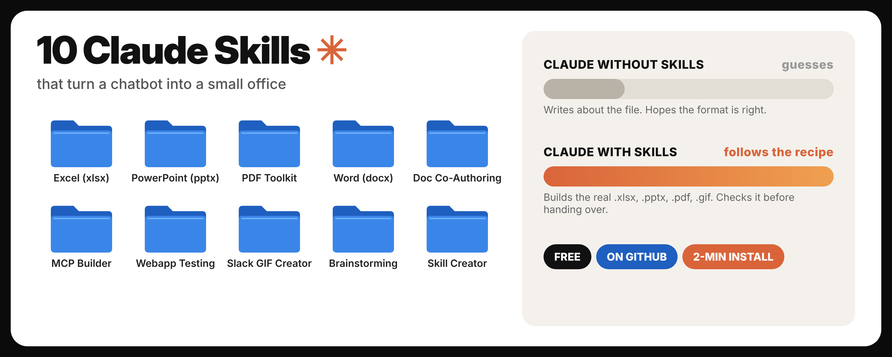
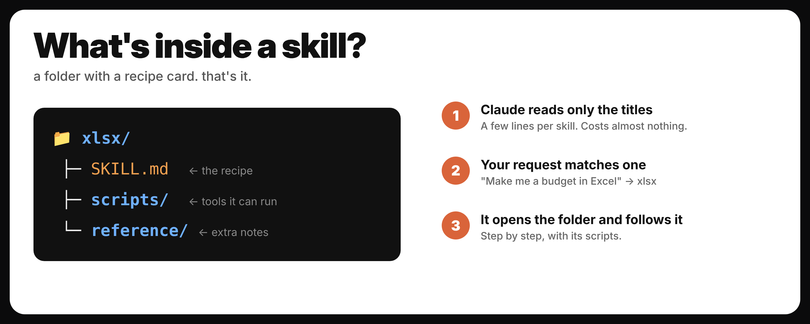
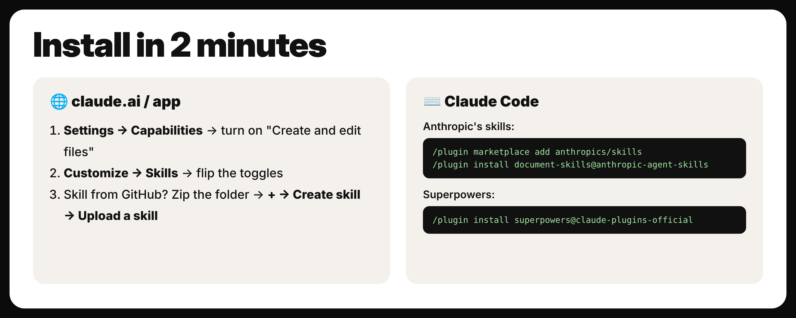

# Claude Skills Starter Pack



10 free Claude skills that turn a chatbot into a small office, explained for total beginners. Plus 2 skills of my own you can install in 1 minute.

## What is a skill?



A skill is a folder. Inside is a text file called `SKILL.md` (the instructions) and sometimes a few scripts.

Claude only reads the title and a short description of each skill. When your request matches one, it opens the folder and follows the steps. So you can have 50 skills installed, and Claude still isn't slowed down.

## How to install



**claude.ai / desktop / mobile app** (works on Free, Pro, Max, Team, Enterprise):

1. `Settings → Capabilities` → turn on **Create and edit files** (code execution).
2. `Customize → Skills` → many of Anthropic's skills are already there. Just flip the toggle.
3. Skill from GitHub? Download the folder, zip it, then `Customize → Skills → + → Create skill → Upload a skill`.

**Claude Code** (terminal):

```
/plugin marketplace add anthropics/skills
/plugin install document-skills@anthropic-agent-skills
/plugin install example-skills@anthropic-agent-skills
/plugin install superpowers@claude-plugins-official
```

## The 10 skills

| # | Skill | What it does, in plain words | Try saying | Link |
|---|---|---|---|---|
| 1 | **Excel (xlsx)** | Builds and fixes real spreadsheets. Formulas stay formulas, so change 1 number and the whole sheet updates. | "Make a monthly budget in Excel with totals and a chart." | [GitHub](https://github.com/anthropics/skills/tree/main/skills/xlsx) |
| 2 | **PowerPoint (pptx)** | Real .pptx decks you can edit. Native charts, speaker notes, can read an old deck too. | "Turn these notes into a 10-slide pitch deck." | [GitHub](https://github.com/anthropics/skills/tree/main/skills/pptx) |
| 3 | **PDF Toolkit** | Merge, split, rotate, watermark, fill forms, pull tables out, OCR scans. | "Merge these 3 PDFs and pull the table on page 7 into Excel." | [GitHub](https://github.com/anthropics/skills/tree/main/skills/pdf) |
| 4 | **Word (docx)** | Proper Word files: headings, table of contents, page numbers, tracked changes. | "Write my CV as a 1-page Word file." | [GitHub](https://github.com/anthropics/skills/tree/main/skills/docx) |
| 5 | **Doc Co-Authoring** | Claude interviews you, writes section by section, then tests the doc on a fresh Claude that knows nothing. | "Help me write a project proposal." | [GitHub](https://github.com/anthropics/skills/tree/main/skills/doc-coauthoring) |
| 6 | **MCP Builder** | Builds a "plug" (MCP server) that connects Claude to any app with an API. | "Build an MCP server so you can read my Shopify orders." | [GitHub](https://github.com/anthropics/skills/tree/main/skills/mcp-builder) |
| 7 | **Webapp Testing** | Opens your site in a real browser, clicks, fills forms, screenshots, reads errors. | "Check if the signup form on localhost:3000 works." | [GitHub](https://github.com/anthropics/skills/tree/main/skills/webapp-testing) |
| 8 | **Slack GIF Creator** | Small animated GIFs: 128×128 emoji or 480×480 message size. | "Make a GIF of a coffee cup filling up, emoji size." | [GitHub](https://github.com/anthropics/skills/tree/main/skills/slack-gif-creator) |
| 9 | **Brainstorming** (Superpowers) | Before building, Claude asks what you want and why, shows 2–3 approaches, you pick. | "I want to build a landing page for my course." | [GitHub](https://github.com/obra/superpowers) |
| 10 | **Skill Creator** | The skill that makes skills. Describe your routine, get a ready folder. | "Turn my weekly report routine into a skill." | [GitHub](https://github.com/anthropics/skills/tree/main/skills/skill-creator) |

## Bonus: my own skills (in this repo)

| Skill | What it does | Download |
|---|---|---|
| **x-post-writer** | Writes X (Twitter) posts for the 2026 algorithm: hook with a number in line 1, built for replies, no links or hashtags, no AI-slop words. | [x-post-writer.zip](dist/x-post-writer.zip) |
| **write-like-a-human** | Rewrites any text so it doesn't sound like AI: varied rhythm, contractions, specifics, banned-word list. | [write-like-a-human.zip](dist/write-like-a-human.zip) |

Download the .zip → `Customize → Skills → + → Create skill → Upload a skill` → toggle on. Done.

## FAQ

**Do I need to code?** No. On claude.ai you only flip toggles or upload a zip.

**Is it free?** Every skill here is free and open on GitHub. Skills work on the Free plan too.

**Where do I start?** Pick the 1 skill that matches the task you hate most this week.

---

Skills in the table belong to their authors (Anthropic, Jesse Vincent). This repo only links to them. My own skills: MIT license.
